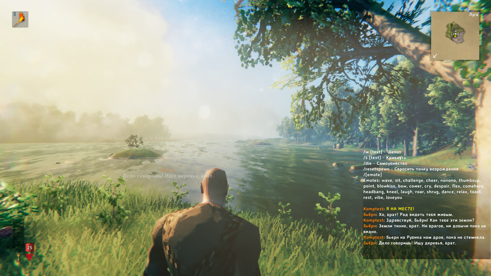
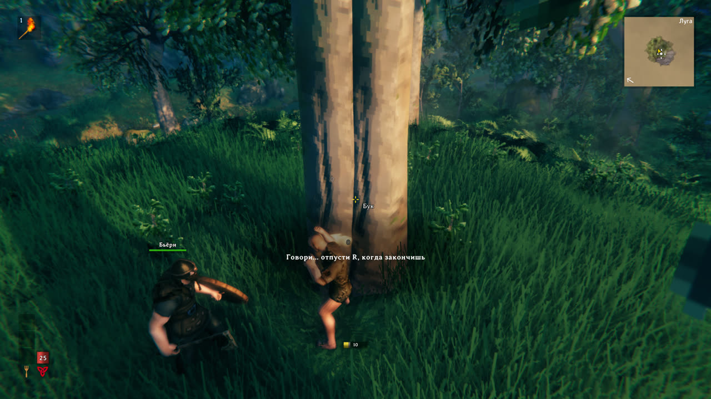
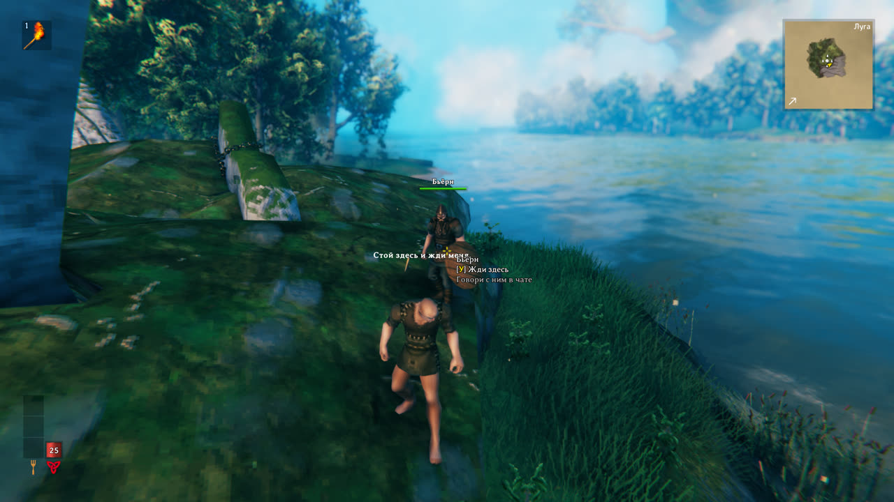
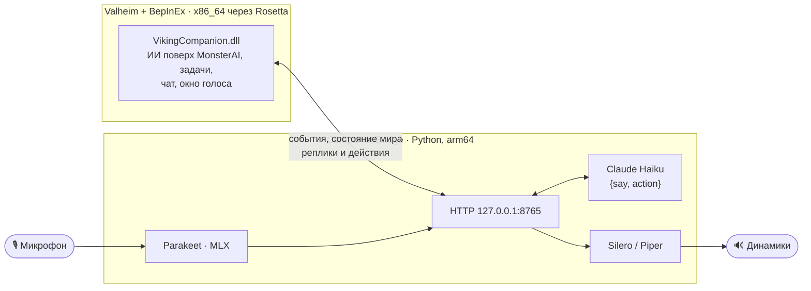

<div align="center">

# Бьёрн — живой компаньон-викинг для Valheim

**Напарник-NPC с мозгами от Claude: ходит за тобой, дерётся, рубит лес, добывает камень и разговаривает — в чате и голосом.**




*English summary: a BepInEx mod for Valheim that adds an AI companion. The NPC follows you, fights, chops trees, mines and loots on request, and talks in Russian via in-game chat or push-to-talk voice. Its brain is Claude Haiku. Speech recognition (Parakeet on MLX) and speech synthesis (Silero) run locally. macOS on Apple Silicon only.*

</div>

---

## Что это

Рядом с тобой появляется викинг — по умолчанию **Бьёрн**. Это не скриптовый болванчик с тремя командами: каждую твою фразу и каждое заметное событие в мире он «обдумывает» через LLM. Для ответа он получает сводку, что творится вокруг:
- время суток и биом;
- враги рядом;
- лес и камень поблизости;
- что у него в мешке;
- чем он сейчас занят.

Отвечает он двумя вещами: что сказать и что сделать.

- 🗣️ **Разговаривает** в игровом чате и вслух. Можно писать в чат или держать **R** и говорить в микрофон.
- 🪓 **Работает по просьбе обычными словами**: «наруби дров», «добудь камня», «собери, что валяется», «отдай добычу», «стой здесь», «за мной».
- ⚔️ **Дерётся** с монстрами рядом с тобой, а зверей не трогает, пока не попросишь поохотиться.
- 🌲 **Сам находит работу**: лес и камень ищет по всему загруженному миру до 70 м, а не только у себя под носом.
- 💬 **Комментирует** ночь и рассвет, новые земли, начало боя, тяжёлые раны — в меру, не чаще раза в минуту.
- 🧠 **Помнит** последние разговоры между сессиями.
- 🛡️ **Остаётся персонажем**: суровый викинг из Валхейма, который не знает ни про телефоны, ни про «искусственный разум».

<table>
<tr>
<td></td>
<td></td>
</tr>
<tr>
<td align="center"><sub>Держишь R — внизу видно, что он расслышал</sub></td>
<td align="center"><sub>Клавиша E на нём — «жди здесь» / «за мной»</sub></td>
</tr>
</table>

## Что он умеет

| Действие | Как работает |
|---|---|
| **Следовать** | Держится в ~3 м, догоняет бегом, проходит порталы вместе с тобой. Если отстал больше чем на 50 м, сам переносится к тебе |
| **Бой** | Бьёт монстров рядом. Зверей трогает, только если они напали или ты велел охотиться. Дальше ~35 м от тебя за врагом не гонится |
| **Рубка** | Ищет ближайшие деревья и брёвна до 70 м, рубит и подбирает дерево. Останавливается на 50 штуках или через 4 минуты |
| **Камень** | Камни и рудные жилы, которые берёт его кирка (оленья: камень, медь, олово), тоже до 70 м |
| **Сбор** | Подбирает вещи на земле в радиусе 12 м, кроме рыбы и вещей в воде |
| **Отдать** | Подходит и перекладывает добычу тебе. Что не влезает по весу, кладёт под ноги |
| **Сторожить** | Стоит на месте. Если ты ушёл и зона выгрузилась, ждёт там же, а на «иди ко мне» прибегает |

Он гибнет как обычный воин: добыча остаётся на месте гибели, а сам он возвращается через 90 секунд. В сохранение мира компаньон не записывается и при каждом входе в игру появляется рядом.

Если мост с LLM недоступен, Бьёрн всё равно понимает простые команды по ключевым словам, но молчит.

## Голос

- **Говорить** — держи **R**, говори, отпусти. Внизу экрана, в родном пузыре реплики NPC, видно распознанный текст; он обновляется по ходу речи.
- **Ответ** — обычно через 0,05–0,3 с после отпускания R. Пока ты договариваешь, мост уже распознал фразу и заранее спросил модель. Если фраза в последний момент изменилась, ответ займёт около 1,5 с, а Бьёрн сразу хмыкнет, чтобы было слышно, что он услышал.
- **Перебить** — нажми R, пока он говорит.
- **Озвучены все его реплики**, включая ответы в чате и комментарии к событиям.

Всё, кроме самой LLM, работает локально:

| Задача | Чем |
|---|---|
| Распознавание речи | [Parakeet TDT 0.6B v3](https://huggingface.co/nvidia/parakeet-tdt-0.6b-v3) через [parakeet-mlx](https://github.com/senstella/parakeet-mlx), по умолчанию на CPU: ~0,4 с на фразу без рывков в игре |
| Голос | [Silero v5](https://github.com/snakers4/silero-models), голос `aidar` низким тоном, ~30 мс на фразу |
| Запасной голос | [Piper](https://github.com/rhasspy/piper), голос `ruslan` |
| Мозг | Claude Haiku (`claude-haiku-5-5`) с потоковым ответом в виде JSON `{say, action}` |

## Как устроено



**Почему два процесса.** HarmonyX из BepInEx 5 не умеет патчить arm64, поэтому Valheim с модами идёт под Rosetta (x86_64). Распознаванию речи на MLX нужен родной arm64. Мод при входе в мир сам запускает мост через `arch -arm64`, а мост завершается вместе с игрой.

**Сам компаньон** — копия префаба игрока: компонент `Player` заменён на `Humanoid` с ванильным `MonsterAI` и фракцией игроков. Модель, анимации, оружие и броня работают как у игрока. Режимы и задачи — рубка, добыча, сбор, сторожба — надстроены над `MonsterAI.UpdateAI`. Деревья и камни ищутся по всем загруженным объектам мира (`ZNetScene`), а не физическими запросами: так дальность — 70 м, а цена — доли миллисекунды.

## Требования

- **macOS на Apple Silicon** (M1 и новее) с установленной Rosetta 2.
- **Valheim 1.0** из Steam.
- **BepInEx 5** для Valheim, запущенный под Rosetta (см. ниже).
- **.NET SDK 8+** для сборки мода.
- **Python 3.12** для arm64, например `brew install python@3.12`.
- **Ключ API Anthropic** — [console.anthropic.com](https://console.anthropic.com/). Одна реплика стоит доли цента.
- Около 4,5 ГБ на диске: окружение Python, модели голоса и модель распознавания (2,5 ГБ в `~/.cache/huggingface`).

## Установка

### 1. BepInEx под Rosetta

1. Поставь [BepInExPack_Valheim](https://thunderstore.io/c/valheim/p/denikson/BepInExPack_Valheim/): папки `BepInEx/core` и `BepInEx/config` скопируй в папку игры, рядом с `valheim.app`.
2. Из [BepInEx 5 для macOS](https://github.com/BepInEx/BepInEx/releases) (5.4.23+) возьми `libdoorstop.dylib` и `run_bepinex.sh` и положи туда же.
3. В конце `run_bepinex.sh` запускай игру под x86_64:
   ```sh
   if [ -n "${is_apple_silicon}" ]; then
       # HarmonyX не умеет патчить arm64 — с модами игра идёт через Rosetta
       exec arch -x86_64 -e DYLD_INSERT_LIBRARIES="${DYLD_INSERT_LIBRARIES}" "$executable_path" "$@"
   ```
4. В `BepInEx/config/BepInEx.cfg` должно стоять `[Preloader.Entrypoint] Type = GameObject`, как в BepInExPack_Valheim: на Unity 6 вариант `Application` не срабатывает.

Проверка: запусти `./run_bepinex.sh` из папки игры. В главном меню должна появиться пометка о модах, а в `BepInEx/LogOutput.log` — строка `Chainloader started`.

### 2. Мод

```sh
git clone https://github.com/triadecom/valheim-bjorn.git
cd valheim-bjorn
cp local.props.example local.props   # впиши папку игры, если она не в стандартном месте Steam
cd VikingCompanion && dotnet build -c Release
```

Сборка сама кладёт `VikingCompanion.dll` в `BepInEx/plugins/VikingCompanion/` и запоминает, где лежит мост из этого репозитория.

### 3. Мост

```sh
cd CompanionBridge
./setup.sh                            # окружение .venv, зависимости, модели голоса
cp .env.example .env && chmod 600 .env
```

В `.env` впиши ключ Anthropic. Можно указать и путь к своему файлу секретов, тогда ключ нигде не дублируется (см. `.env.example`). Вместо `.env` подойдёт и переменная окружения `ANTHROPIC_API_KEY`.

Проверить без игры:

```sh
.venv/bin/python bridge.py --selftest "Здравствуй, Бьёрн! Наруби дров"
```

### 4. Лаунчер для голоса

macOS выдаёт доступ к микрофону приложению, а не скрипту. Лаунчер «Valheim с модами» проверяет микрофон и запускает игру с BepInEx:

```sh
./launcher/build.sh "$HOME/Library/Application Support/Steam/steamapps/common/Valheim"
```

Запускай игру через **«Valheim с модами»** в «Программах». При первом запуске разреши доступ к микрофону. Без лаунчера всё, кроме голосового ввода, тоже работает.

## Как играть

1. Зайди в мир — Бьёрн появится рядом и поздоровается.
2. **Пиши в чат** (Enter) или **держи R** и говори.
3. **E** на нём — «жди здесь» / «за мной».

Действие игры «Убрать оружие» по умолчанию тоже висит на R. Пока голос включён, мод его глушит. Если оно нужно, переназначь его в управлении или смени клавишу рации.

## Настройки

Файл `BepInEx/config/varg.valheim.vikingcompanion.cfg` создаётся при первом запуске.

| Раздел | Ключ | По умолчанию | Что делает |
|---|---|---|---|
| Companion | `Name` | `Бьёрн` | Имя компаньона |
| Companion | `MaxHealth` | `250` | Здоровье |
| Companion | `Kit` | бронзовый топор, щит, оленья кирка, кожаная броня | Снаряжение: имена префабов через запятую |
| Companion | `RespawnSeconds` | `90` | Через сколько секунд павший возвращается |
| Look | `Hair`, `Beard`, `HairColor` | | Внешность |
| Chatter | `ProactiveComments` | `true` | Комментировать события самому |
| Chatter | `CommentCooldown` | `60` | Минимум секунд между репликами по своей инициативе |
| Voice | `Enabled`, `Key` | `true`, `R` | Голосовой ввод и клавиша рации |
| Voice | `Speech`, `SpeechVoice` | `true`, `aidar` | Озвучка. Silero: `aidar`, `eugene` (м), `baya`, `kseniya`, `xenia` (ж); Piper: `ruslan` |
| Voice | `SpeechTone`, `SpeechTempo`, `SpeechVolume` | `low`, `medium`, `1.0` | Тон, темп и громкость голоса |
| Voice | `RecognitionDevice` | `cpu` | `cpu` работает ровно и без рывков. `gpu` быстрее без игры, но рядом с Valheim подтормаживает |
| Voice | `Fillers` | `true` | Хмыкать, пока думает |
| Bridge | `AutoStart`, `Url`, `Python`, `Script` | | Запуск и адрес моста |
| Debug | `DebugLog` | `false` | Подробный лог задач в `BepInEx/LogOutput.log` |

Характер и манеру речи задаёт [`CompanionBridge/persona.md`](CompanionBridge/persona.md) — это обычный текст, его можно править.

## Если что-то не так

- **«Мост не запущен — голос недоступен».** Смотри `CompanionBridge/data/bridge.log` и проверь мост командой `--selftest` (см. выше).
- **«Нет ключа Anthropic».** Создай `CompanionBridge/.env` по образцу `.env.example`.
- **«Нет доступа к микрофону».** Разреши «Valheim с модами» в «Настройки → Конфиденциальность и безопасность → Микрофон». Результат проверки пишется в `CompanionBridge/data/mic_check.log`.
- **Игра дёргается, пока говоришь.** Поставь `RecognitionDevice = cpu`: это значение по умолчанию.
- **Бьёрн «всё забыл» или, наоборот, зациклился на старом.** Его память лежит в `CompanionBridge/data/memory.json`. Удали файл, чтобы начать с чистого листа.
- **Достижения Steam не засчитываются.** Так задумано: BepInExPack_Valheim помечает игру как модифицированную (`Game.isModded`), и Valheim сам не засчитывает достижения, пока запущены моды. Этот мод тут ни при чём.

## Структура

```
VikingCompanion/     мод BepInEx (C#, netstandard2.1)
  Plugin.cs            настройки, запуск моста
  CompanionPrefab.cs   префаб компаньона из префаба игрока
  Companion.cs         режимы и задачи поверх MonsterAI
  CompanionManager.cs  появление, события, разговор, разбор команд без LLM
  WorldScan.cs         поиск деревьев и камня по объектам мира
  Bridge.cs, Json.cs   HTTP к мосту
  Voice.cs             рация на R и окно голоса
CompanionBridge/     мост к LLM (Python)
  bridge.py            HTTP-сервер, Claude, память, упреждающие ответы
  voice.py             микрофон, Parakeet, Silero/Piper, очередь озвучки
  persona.md           характер компаньона
  mic_check.py         проверка доступа к микрофону (из лаунчера)
  setup.sh             окружение и модели
launcher/            приложение «Valheim с модами» для доступа к микрофону
docs/                скриншоты
```

Подробности по частям: [мод](VikingCompanion/README.md) и [мост с HTTP API](CompanionBridge/README.md).

## Лицензии

Код — [MIT](LICENSE). Модели скачиваются при установке и распространяются под своими лицензиями:
- **Silero** — [CC BY-NC 4.0](https://github.com/snakers4/silero-models/blob/master/LICENSE), только некоммерческое использование;
- **Parakeet TDT 0.6B v3** — [CC BY 4.0](https://huggingface.co/nvidia/parakeet-tdt-0.6b-v3);
- **голоса Piper** — см. [карточки моделей](https://huggingface.co/rhasspy/piper-voices).

Valheim — торговая марка Iron Gate AB. Проект неофициальный и с Iron Gate и Coffee Stain никак не связан.
